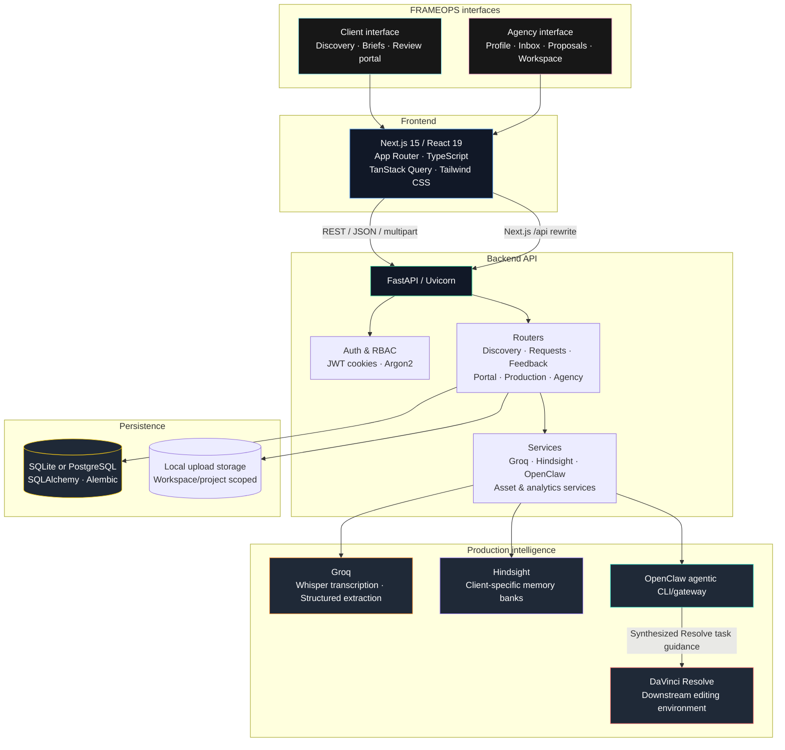
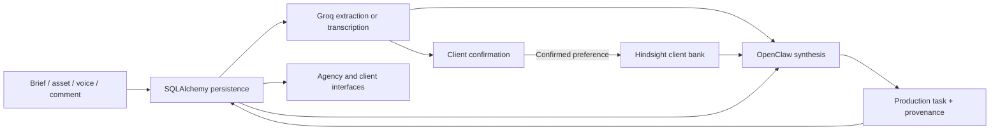

# FRAMEOPS

**Client-to-agency video production operations, with AI-assisted feedback intelligence.**

[](#license)
[](backend/)
[](frontend/)
[](#database-and-data-flow)
[](backend/pyproject.toml)
[](frontend/package.json)

FRAMEOPS is a full-stack, two-sided platform for video production agencies and their clients. It combines agency discovery, project briefs, proposals, accepted-project operations, asset management, timestamped review, feedback extraction, production task synthesis, and client-specific preference memory in one application.

The repository is maintained at [HNK69/FrameOS](https://github.com/HNK69/FrameOS).

> **Implementation note:** Core two-sided workflows and the client review portal are implemented. Groq, Hindsight, and OpenClaw integrations are code-backed, configuration-dependent integrations and may degrade gracefully when credentials or services are unavailable. DaVinci Resolve is a downstream synthesis target, not a directly controlled editing environment.

---

## Table of Contents

- [Why FRAMEOPS](#why-frameops)
- [Project Objectives](#project-objectives)
- [Key Capabilities](#key-capabilities)
- [Implemented Lifecycle](#implemented-lifecycle)
- [System Architecture](#system-architecture)
- [Technology Stack](#technology-stack)
- [AI and Production Intelligence](#ai-and-production-intelligence)
- [Database and Data Flow](#database-and-data-flow)
- [Security](#security)
- [API Overview](#api-overview)
- [Project Structure](#project-structure)
- [Prerequisites](#prerequisites)
- [Local Setup](#local-setup)
- [Docker Compose](#docker-compose)
- [Environment Variables](#environment-variables)
- [Testing](#testing)
- [Current Status](#current-status)
- [Roadmap](#roadmap)
- [Contributing](#contributing)
- [License](#license)

---

## Why FRAMEOPS

Video production collaboration is often split across email threads, file-sharing links, chat applications, spreadsheets, and subjective feedback. Critical context can be lost between the client, agency, editor, and final review.

FRAMEOPS organizes that lifecycle around a shared operational record:

1. Agencies publish profiles and receive structured briefs.
2. Clients discover agencies and compare proposals.
3. An accepted proposal creates an active project.
4. Assets, runs, tasks, feedback, comments, and decisions remain associated with the project.
5. AI services help extract requirements, recall client preferences, and synthesize editing guidance.
6. Confirmed feedback can be retained in client-specific memory for future recommendations.

The result is a single application for commercial handoff, production tracking, and client review rather than a collection of disconnected tools.

## Project Objectives

- Provide separate, role-aware experiences for clients and agency teams.
- Support a complete brief-to-acceptance lifecycle.
- Keep agency and client data scoped to the appropriate workspace or user.
- Preserve source evidence and human confirmation in AI-assisted workflows.
- Separate transient extraction, actionable tasks, editor feedback, and permanent client preferences.
- Provide timestamped video review and explicit approve/change-request decisions.
- Make external AI providers optional and isolate provider failures from core database operations.
- Support SQLite for local development and PostgreSQL for containerized/shared deployments.

## Key Capabilities

### Client

- Register and log in with a client persona.
- Manage a client profile and company details.
- Browse published agency profiles and filter by specialization, service, or category.
- Inspect agency portfolios and contact details.
- Create, update, list, and review project briefs.
- Submit briefs as drafts or completed submissions.
- View and compare agency proposals.
- Accept or decline proposals.
- Provide project assets and reference links.
- Use a project review portal with video playback and timestamped comments.
- Approve a delivery or request changes.
- Submit text or audio feedback and confirm extracted requirements.

### Agency

- Register an agency workspace and authenticate with an agency persona.
- Build and publish an agency profile.
- Showcase portfolio items, specializations, and services.
- Receive and filter client project requests.
- Review briefs and submit proposals.
- Communicate with clients through request and project message threads.
- Create and activate projects from accepted proposals.
- Upload production assets.
- Review client feedback and audio submissions.
- Convert delivered feedback into production tasks.
- Manage task status and editor corrections.
- View operational analytics and asset-intelligence correlations.

## Implemented Lifecycle

```mermaid
flowchart LR
    C[Client registration] --> D[Agency discovery]
    D --> B[Structured project brief]
    B --> I[Agency inbox review]
    I --> P[Agency proposal]
    P --> A{Client decision}
    A -->|Decline| P
    A -->|Accept| W[Active project created]
    W --> AS[Asset submission]
    AS --> PR[Production and review version]
    PR --> FB[Timestamped feedback]
    FB --> AI[Groq extraction]
    AI --> CO[Human confirmation]
    CO --> TC[Production task]
    TC --> RV[Revision]
    RV --> AP{Client decision}
    AP -->|Changes requested| FB
    AP -->|Approved| DONE[Project complete]
```



The implementation covers project requests, proposal acceptance, project activation, comments, review decisions, feedback extraction, and production-task conversion. Final project completion is represented through project/review status data; the repository does not describe an external delivery or billing pipeline.

---

## System Architecture



### Request and data boundaries

- The Next.js application serves the client, agency, portal, and production interfaces.
- In local development, browser/API calls are proxied by Next.js rewrites to `BACKEND_URL`, defaulting to `http://localhost:8001`.
- FastAPI exposes REST endpoints under `/api`.
- Agency workspace APIs resolve the workspace through role and membership data.
- Public discovery only exposes published agency profiles.
- Project, asset, feedback, task, comment, and memory operations are scoped to a workspace or authenticated client identity.
- SQLAlchemy uses SQLite WAL mode and a busy timeout for local SQLite; PostgreSQL is selectable through `DATABASE_URL`.
- Uploads are stored on a local filesystem volume/directory and referenced from the database.

## Technology Stack

| Layer | Actual repository technology |
|---|---|
| Frontend framework | Next.js 15.5, React 19.1 |
| UI and forms | TypeScript 5.9, Tailwind CSS 4, Framer Motion, Lucide React |
| Client state | TanStack React Query 5 |
| Form/validation | React Hook Form 7, Zod 4, `@hookform/resolvers` |
| Charts | Recharts 2 |
| Backend framework | FastAPI, Uvicorn |
| API validation | Pydantic, Pydantic Settings |
| Database | SQLAlchemy 2, Alembic, SQLite local default, PostgreSQL 16 via Docker |
| Authentication | PyJWT, pwdlib with Argon2, HTTP-only persona cookies |
| HTTP and multipart | HTTPX, python-multipart |
| Testing | pytest, pytest-asyncio, Node `node:test` |
| Code quality | Ruff |
| Package/runtime tools | uv, npm, Docker/Docker Compose |
| AI transcription/extraction | Groq OpenAI-compatible API |
| Persistent memory | Hindsight HTTP API |
| Agent orchestration | OpenClaw CLI/gateway |
| Intended downstream editor | DaVinci Resolve task guidance |

### Technology badges


Technology badges identify implementations discovered in the repository; they do not imply commercial endorsements or partnerships.

## AI and Production Intelligence

### Implemented pipeline behavior

1. **Groq transcription**
   - Feedback text and audio are accepted through the feedback API.
   - Audio is transcribed with Groq's `whisper-large-v3-turbo` model.
   - Text extraction uses the configured Groq chat model and JSON schema.
   - Long text is split with a character-based approximation of 4,000 tokens and 200-token overlap.
   - Groq calls include HTTP 429 retry handling.

2. **Hindsight memory**
   - Each operational client can be mapped to a dedicated Hindsight bank ID.
   - Bank IDs are generated by the application and persisted with the client.
   - Recall and retain operations record memory provenance and status in SQLAlchemy models.
   - Retention verifies the selected document by recalling and matching it against source text.
   - Failed recall can degrade to an empty memory set rather than abort synthesis.

3. **Human confirmation**
   - Extracted items carry classifications and confirmation requirements.
   - Confirmed feedback is the boundary between extraction and retained client memory.
   - The portal submit flow passes confirmed information into client-specific memory retention.
   - AI output is not silently promoted to permanent memory or assumed to be editor instruction.

4. **OpenClaw synthesis**
   - OpenClaw receives extraction output, recalled evidence, and asset availability.
   - The service requests a concise DaVinci Resolve-oriented task as structured JSON.
   - Ambiguous or low-confidence work is marked as requiring confirmation.
   - Provider/process failures are recorded as service failures rather than fabricated successful tasks.

5. **DaVinci Resolve**
   - DaVinci Resolve is represented as the intended downstream environment.
   - The repository synthesizes task instructions and workflows; it does **not** control Resolve, load timelines, render projects, or execute editing operations directly.

### Provider status boundary

The `/api/ready` endpoint reports provider configuration state, database readiness, and whether required configuration appears available. It does not replace credential verification or prove an external provider remains reachable. Provider behavior should be considered:

- **Groq:** implemented when API key and model are configured.
- **Hindsight:** implemented when URL/token are configured, with degradation when unavailable.
- **OpenClaw:** implemented through CLI/gateway invocation when executable and gateway configuration are available.
- **DaVinci Resolve:** downstream target/planned integration; direct automation is not implemented.

## Database and Data Flow

### Core models

- `users`, `memberships`, `workspaces`
- `agency_profiles`, `client_profiles`
- `project_requests`, `proposals`, `project_messages`
- `clients`, `projects`, `assets`
- `transcripts`, `processing_runs`, `extracted_items`
- `production_tasks`, `feedback`
- `client_feedback`, `memory_operations`
- `client_portal_access`, `review_versions`, `video_comments`, `client_feedback_submissions`

### Migration chain

Alembic migrations are linear:

```text
05cc8ac7f846
  -> a891c354b0f2
  -> a1b2c3d4e5f6
  -> b2c3d4e5f6a7
```

The latest migration adds agency profiles, client profiles, project requests, proposals, and project messages.

### Data flow



The operational database remains the source of truth for records and provenance. Hindsight is memory-oriented supplementary state, while Groq and OpenClaw results are persisted or represented with error/status data.

## Security

The repository implements:

- Argon2 password/passcode hashing through `pwdlib`.
- Separate `frameops_session` and `frameops_client_session` HTTP-only cookies.
- JWT bearer/cookie authentication and server-side logout revocation.
- Role-aware client/agency authorization guards.
- Workspace scoping for agency resources.
- Client-scoped portal project/comment access.
- Public discovery restricted to published agency profiles.
- CORS allow-list configuration.
- Security headers including `nosniff`, frame policy, referrer policy, permissions policy, and optional HSTS.
- Upload filename/type validation and size limits.
- Safe attachment downloads with `Content-Disposition` attachment mode.
- Idempotency for transcript and feedback/task conversion operations.
- Provider and memory operations with failure/status recording.

Additional production hardening planned in [TODO.md](TODO.md):

- Redis-backed rate limiting and CSRF protection.
- A full team-member/owner/admin/editor/viewer authorization matrix.
- Private object storage and presigned URLs.
- Background workers for long-running provider jobs.
- Managed PostgreSQL backups and disaster-recovery procedures.

> Redis is present as a configuration field but is not evidenced as a complete active rate-limiting or queue implementation. CSRF, team invitations, and presigned object storage should not be described as implemented.

## API Overview

Interactive API documentation is available from FastAPI at `/docs` when the backend is running.

| Area | Representative routes |
|---|---|
| Health | `GET /api/health`, `GET /api/ready` |
| Authentication | `POST /api/auth/setup`, `POST /api/auth/register/client`, `POST /api/auth/register/agency`, `POST /api/auth/login`, `POST /api/auth/logout`, `GET /api/me` |
| Agency profile | `GET/PUT /api/agency/profile`, `POST /api/agency/profile/publish`, `POST /api/agency/profile/unpublish` |
| Public discovery | `GET /api/discovery/agencies`, `GET /api/discovery/agencies/{workspace_id}` |
| Client requests | `POST/GET /api/client/requests`, `GET/PATCH /api/client/requests/{id}`, `GET /api/client/requests/{id}/proposals`, accept/decline proposal routes |
| Agency requests | `GET /api/agency/requests`, `GET /api/agency/requests/{id}`, create/update proposals |
| Messaging | `POST/GET /api/requests/{id}/messages`, `GET /api/agency/requests/{id}/messages`, direct message routes |
| Client/agency data | `GET/POST/PATCH/DELETE /api/clients`, `GET/POST/PATCH/DELETE /api/projects` |
| Assets | `POST /api/projects/{id}/assets`, `GET /api/assets/{id}/download`, `GET /api/portal/assets/{id}/stream` |
| Processing | `POST /api/process-transcript`, `GET /api/runs/{id}` |
| Tasks | `GET/PATCH /api/tasks`, `POST /api/tasks/{id}/feedback` |
| Feedback | `POST /api/feedback`, `POST /api/feedback/audio`, status/retry/confirmation routes, agency deliver/convert-task routes |
| Portal | `POST /api/portal/auth/login`, project, comment, voice, decision, and feedback routes |
| Intelligence | `/api/production-analytics`, `/api/projects/{id}/asset-intelligence`, `/api/clients/{id}/adaptive-knowledge` |

For exact request schemas and route behavior, use the FastAPI OpenAPI document generated from [backend/app/main.py](backend/app/main.py) and the modular routers.

## Project Structure

```text
FrameOPS/
├── backend/
│   ├── app/
│   │   ├── main.py                 # FastAPI app, middleware, core routes
│   │   ├── config.py               # Pydantic environment settings
│   │   ├── db.py                   # SQLAlchemy engine and session
│   │   ├── models.py               # ORM models
│   │   ├── schemas.py              # API request/response schemas
│   │   ├── security.py             # JWT, cookies, hashing, guards
│   │   ├── routers/                # Auth, discovery, profile, requests, portal, feedback
│   │   └── services/               # Groq, Hindsight, OpenClaw, analytics
│   ├── alembic/versions/           # Linear database migrations
│   ├── tests/                      # Unit and end-to-end API test suites
│   ├── scripts/                    # Verification and workflow utilities
│   ├── pyproject.toml
│   └── Dockerfile
├── frontend/
│   ├── app/                        # Next.js App Router pages
│   ├── components/                 # Shared and production UI components
│   ├── lib/api.ts                  # API client
│   ├── tests/                      # Node unit tests
│   ├── package.json
│   └── Dockerfile
├── storage/uploads/                # Local uploaded file storage
├── .env.example                    # Safe configuration template
├── docker-compose.yml              # PostgreSQL, API, and frontend services
├── ARCHITECTURE.md
├── PROJECT_STATUS.md
└── TODO.md
```

## Prerequisites

### Native local development

- Python 3.12 or newer
- `uv` (recommended) or a Python virtual environment and `pip`
- Node.js 20 or newer
- npm

### Optional integrations

- Groq account/API key and enabled chat model
- Hindsight deployment URL and token
- OpenClaw CLI and gateway credentials
- DaVinci Resolve on a downstream workstation when manually using synthesized task guidance

Node.js 22 is used by the repository's frontend Docker image. No runtime version guarantee is made for external OpenClaw installations.

## Local Setup

Run all commands from the repository root unless noted.

### 1. Create backend configuration

Copy the safe template:

```powershell
Copy-Item .env.example backend\.env
```

Set at least `AUTH_SECRET` before creating accounts. Use your own random value; never reuse or commit a real secret.

### 2. Install and initialize the backend

```powershell
cd backend
uv sync --extra dev
uv run alembic upgrade head
uv run uvicorn app.main:app --reload --host 127.0.0.1 --port 8001
```

The API will be available at `http://127.0.0.1:8001`, with interactive docs at `http://127.0.0.1:8001/docs`.

### 3. Install and start the frontend

In another terminal:

```powershell
cd frontend
npm ci
npm run dev
```

The frontend will run at `http://localhost:3000`.

In development, `frontend/next.config.ts` rewrites `/api/:path*` to `BACKEND_URL` or `http://localhost:8001`. Keep the backend and frontend ports consistent.

### 4. Bootstrap the application

Use the public client or agency registration routes/pages. The legacy workspace setup route remains available for initial workspace bootstrap and requires `AUTH_SECRET`.

## Docker Compose

The Compose stack uses PostgreSQL, the FastAPI Docker image, and the Next.js Docker image:

```powershell
Copy-Item .env.example .env
docker compose up --build
```

Set `POSTGRES_PASSWORD`, `AUTH_SECRET`, and the remaining values in `.env`.

Defaults:

- Frontend: `http://localhost:3000`
- API: `http://localhost:8000`
- PostgreSQL: internal Docker service `postgres:5432`
- API uploads: named Docker volume `frameops-uploads`

The Compose API entrypoint applies Alembic migrations before starting Uvicorn on port `8000`. The frontend Docker build receives `NEXT_PUBLIC_API_URL`, defaulting to `http://localhost:8000`.

Stop the stack without deleting named volumes:

```powershell
docker compose down
```

Do not run database or volume reset commands unless you intentionally accept data loss.

## Environment Variables

Use [.env.example](.env.example) as the safe source template.

| Variable | Used for | Local default/example |
|---|---|---|
| `AUTH_SECRET` | JWT signing; required before auth/setup | set a unique random secret |
| `AUTH_COOKIE_SECURE` | Secure cookie attribute | `false` |
| `AUTH_TOKEN_MINUTES` | JWT lifetime | settings default `720` |
| `FRONTEND_ORIGIN` | application origin metadata | `http://localhost:3000` |
| `CORS_ORIGINS` | comma-separated CORS allow-list | `http://localhost:3000` |
| `DATABASE_URL` | SQLite or PostgreSQL SQLAlchemy URL | `sqlite:///./frameops.db` |
| `GROQ_API_KEY` | Groq authentication | empty/unconfigured |
| `GROQ_MODEL` | extraction chat model | empty/unconfigured |
| `GROQ_BASE_URL` | Groq OpenAI-compatible base URL | `https://api.groq.com/openai/v1` |
| `HINDSIGHT_API_URL` | Hindsight API base URL | empty/unconfigured |
| `HINDSIGHT_API_TOKEN` | Hindsight bearer token | empty/unconfigured |
| `OPENCLAW_GATEWAY_URL` | OpenClaw gateway URL | empty/unconfigured |
| `OPENCLAW_AUTH_TOKEN` | OpenClaw gateway auth | empty/unconfigured |
| `OPENCLAW_GATEWAY_TOKEN` | alternate gateway environment token | optional |
| `OPENCLAW_AGENT_ID` | OpenClaw agent identity | `main` |
| `OPENCLAW_BIN` | explicit OpenClaw executable | optional |
| `OPENCLAW_NODE_BIN` | explicit Node executable | optional |
| `UPLOAD_DIR` | local upload directory | `../storage/uploads` for backend cwd |
| `MAX_UPLOAD_BYTES` | upload size limit | `26214400` |
| `POSTGRES_PASSWORD` | Docker Compose PostgreSQL password | required for Compose |
| `NEXT_PUBLIC_API_URL` | browser build/API URL in Compose | `http://localhost:8000` |
| `BACKEND_URL` | Next.js server-side rewrite target | `http://localhost:8001` |
| `LOG_LEVEL` | Python logging level | `INFO` |
| `TRUSTED_PROXIES` | trusted proxy setting | `127.0.0.1,::1` |
| `APP_ENV` | application environment label | `development` |

Backend `.env` loading is also configured for `backend/.env`, `../.env`, and `.env`, in that settings configuration. Docker Compose reads the root `.env`.

Never commit real credentials. The current environment may contain local `.env` or database files; this README does not reproduce or expose their contents.

## Testing

### Backend

From the repository root:

```powershell
cd backend
uv sync --extra dev
uv run pytest --collect-only -q
uv run pytest -q
```

The repository contains unit, boundary, combination, lifecycle, and browser-oriented test suites. Browser/E2E tests may require Playwright or additional local setup. The test configuration declares `backend/tests` and adds `backend` to `pythonpath`.

The test suite is larger than the focused verification set documented in existing project status files. Some suite marks are also present without pytest marker registration; run output may include unknown-mark warnings.

### Frontend

```powershell
npm --prefix frontend test
npm --prefix frontend run build
npm --prefix frontend run lint
```

`npm run lint` invokes `next lint`, a command that may depend on the installed Next.js CLI behavior for the pinned Next.js version.

### Verification performed for this README update

At the time of documentation validation:

- Frontend unit tests: **2 passed**.
- Frontend Next.js build: **18 routes generated successfully**.
- A representative backend selection covering auth, discovery, requests, feedback, portal, intelligence, and provider mocks: **160 passed**.
- Backend collection: **416 tests collected**.
- A full live 416-test run was not executed, and provider connectivity was not re-probed with secrets during this README update.

## Current Status

### Implemented

- Two-sided public registration and role-aware login.
- Agency profile CRUD and publish/unpublish workflow.
- Public agency discovery.
- Client briefs and agency proposals.
- Proposal acceptance with active project creation.
- Request/project messaging.
- Asset upload and download.
- Client and agency dashboards.
- Client review portal with review versions and timestamped comments.
- Approval/change-request decisions.
- Groq text extraction and audio transcription integration.
- Hindsight client-bank recall/retain behavior.
- OpenClaw task-synthesis invocation.
- Production tasks, analytics, and feedback conversion.
- SQLite WAL mode and PostgreSQL-compatible SQLAlchemy configuration.
- Alembic migrations and Docker Compose.

### Integration boundaries

- External AI services require separately issued configuration.
- Hindsight can degrade to empty recall without aborting synthesis.
- OpenClaw must have an executable and accessible gateway configuration.
- DaVinci Resolve is not controlled or automated by the backend.
- No object-storage, Redis-backed queue/rate limit, or background-worker implementation is established in the repository.
- The actual deployment host, TLS configuration, domain, and production provider status are unknown.
- A public license is not declared in repository metadata inspected here.

## Roadmap

Based on repository TODO and architecture status:

- [ ] Seed interactive demo agencies and sample client data.
- [ ] Add Redis-backed auth mutation rate limiting.
- [ ] Add CSRF protection for cookie-authenticated mutations.
- [ ] Add team-member invitations and a full owner/admin/editor/viewer RBAC matrix.
- [ ] Move uploads to private S3-compatible object storage with presigned URLs.
- [ ] Add a background worker for transcription and synthesis jobs.
- [ ] Configure production PostgreSQL backup and restore procedures.
- [ ] Add centralized tracing, metrics, alerting, and structured operational dashboards.
- [ ] Evaluate direct DaVinci Resolve automation or supported downstream integrations.
- [ ] Add deployment manifests and production infrastructure documentation where applicable.

## Contributing

Repository ownership metadata identifies [HNK69](https://github.com/HNK69) as the maintainer. Before substantial changes:

1. Preserve existing API compatibility and tenant boundaries.
2. Add focused pytest or Node tests.
3. Run the smallest relevant test set, then build/type-check the frontend.
4. Include migrations for model changes.
5. Keep external provider failures explicit and degraded rather than fabricated.
6. Do not commit database files, local `.env` values, credentials, backups, or uploaded media.

## License

A license file or SPDX license declaration was not found in the inspected repository metadata. License terms are therefore unknown; obtain maintainer approval before redistribution or commercial reuse.
